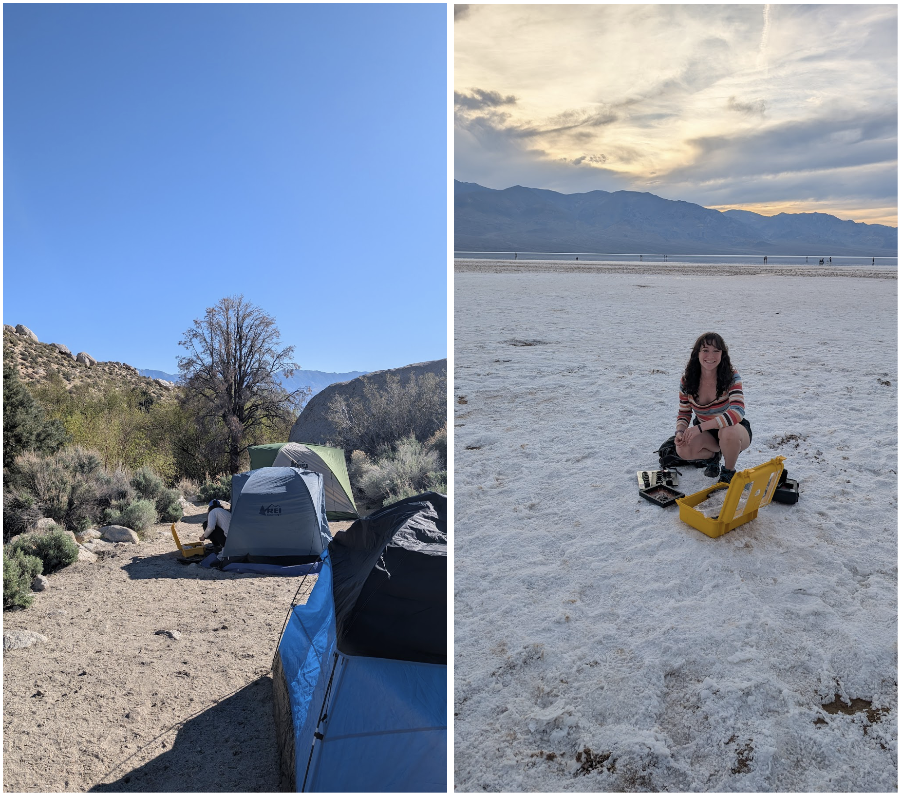
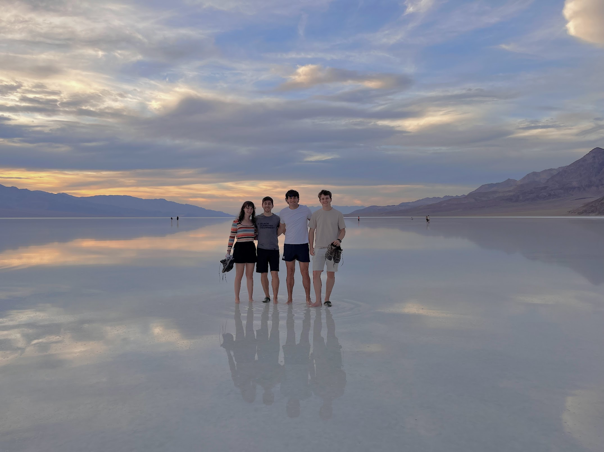

During my time at the Jet Propulsion Laboratory in California, I decided to go to Death Valley with a group of other interns. We were planning on visiting the salt flats when I realized this would be a great opportunity to test my photodiode radiometer designed for Martian cloud detection, as it was a large open space and would make for great photos. As we drove down to Death Valley from Lone Pine, our campsite, I BEGGED the guys to try and make it before the sun hit a zenith angle of 86 so I could get proper sunset measurements. As soon as the car was parked, I ran out with my yellow pelican case and set up my prototype, laptop, and 180 degree camera and took some test shots before enjoying the beauty of the salt flats. I was keeping an eye on my setup from afar, and ran back to shoo people away who were looking like they were going to touch the camera a few times, but otherwise everything was working according to plan.

There was about a foot of water on top of a portion of the salt flats which had resulted in spiky salt crystals but made for stunning photos.  Important information for this story is that I was on this trip with 3 men, fellow JPL interns. Therefore, as I ran along the sharp salt flats barefoot, while they limped, I smugly decided this proved women have higher pain tolerances. I cockily teased them about this as they shared crocs and tried to avoid walking as much as possible.

I ran up and down the salt flats a number of times, tried unsuccessfully to do a bridge in the water (fell in twice, got covered in salt, no regrets, anyone who wants to see a video can ask), and we packed up. It wasn’t until we were in the car that I looked at my feet. They were torn up by the salt, and they stayed swollen for about 4 days. On Monday, when coming back to JPL, I couldn’t fit my usual loafers, while the guys were completely fine. 

The tip I have for other people doing field work is the same advice as the government has for gamblers: know your limit, play within it. If you can feel salt crunching under your feet but it doesn’t hurt much, and everyone else is limping, that might not be proof you’re tough. Get back to dry land and check that you haven’t hurt yourself. Keep in mind your personal limitations as much as possible and don’t hurt yourself unintentionally.

I did get my sunset measurements, and a really beautiful video to go along with it. The next day I left the radiometer out for 6 hours while we went on a hike (My feet held up!), and came back to more excellent footage. Death Valley treated me well. 
<video controls playsinline preload="metadata" width="100%">
  <source src="/5_Death_Valley.mp4" type="video/mp4" />
</video>

<video controls playsinline preload="metadata" width="100%">
  <source src="/3_lone_pine.mp4" type="video/mp4" />
</video>
