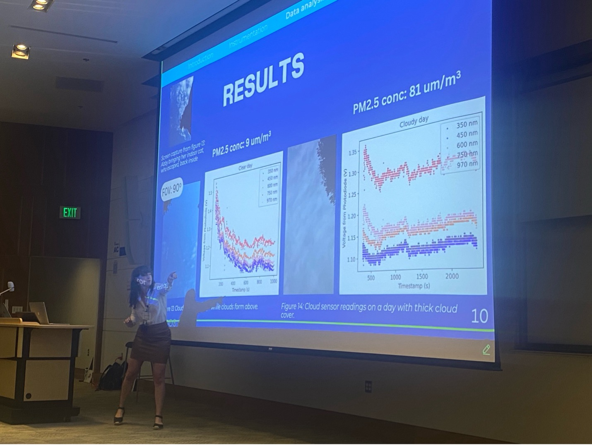
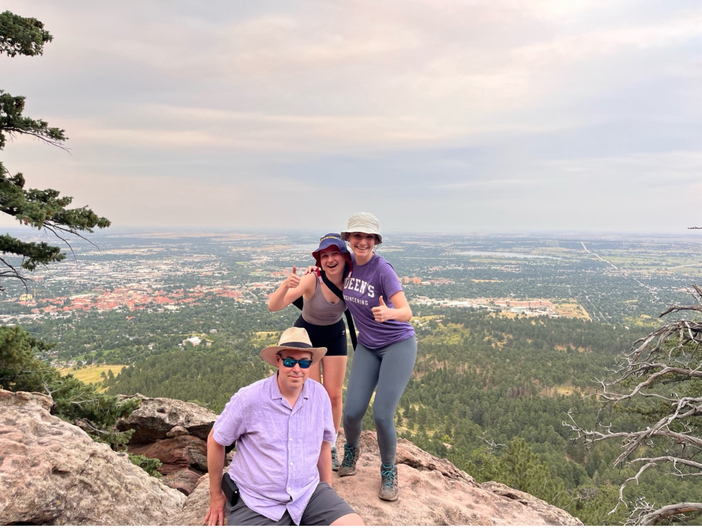

>To be perfectly clear before we begin: I am not a public speaker. I don’t consider myself to be good at presentations, I certainly haven’t had much practice with large crowds, and my brain stops working the moment I open my mouth. For all these reasons, I signed up for a 12-minute oral presentation at the International Meeting for Planetary Missions 6 (IPM) conference. The moment I saw the email pop-up in my inbox indicating that I received a presentation slot, I regretted all my previous decisions. But it was too late – I had no choice but to get prepared. Though I couldn’t have expected it, this presentation ended up being one of the best decisions I could have made.
>The topic of my presentation was a cloud sensor, designed to turn on a camera when Martian clouds are above. However, mere weeks before the conference my sensor prototype was still unfinished, and I had another presentation at a different conference a month after IPM. It was a busy summer to say the least. Gathering my results just 5 days before my presentation – at a time when wildfire smoke concentrations were at the highest level they would be all summer – I found that my sensor could separate smoke from clouds. This was an unexpected, but welcome discovery. IPM itself is unique in that it’s attended by primarily engineers and was completely instrument-focused – completely up my alley.
>Once I had gathered my results and wrapped my mind around their implications for my instrument concept, I decided to tackle the presentation itself. I practiced – wrote and rewrote, stumbled through a rocky presentation within the department, redid the presentation, got a class-A lecture from my airplane seat-mate on how I should “just relax”, practiced some more, anxiously sat through presentation after presentation on instruments with MILLIONS of dollars in funding, all before it was finally my turn. I wanted to vomit.

>After 12 minutes of complete blackout, I found myself back in my seat. I came to and realized: it went well! I got a laugh out of the audience at the very beginning that allowed me to loosen up and relax through the rest of it. Did I make some small mistakes while speaking? Yes. Was I perfectly engaging every corner of the room? No. 
 
>Unfortunately, my worst fear came true.  I got stumped by a question that was perhaps less than relevant to my presentation in front of a room full of world-class scientists I was desperate to impress. I did not give an answer that could in any way be described as coherent, but the moderator stepped in and shut it down. 
>Seasoned scientists and engineers continued to ask interesting questions about my presentation for the rest of the conference – the kindest people, treating me as a peer. My results showing the detection of amounts of wildfire smoke significant enough to override the thick cloud cover above caught attention and brought questions about making a similar version of the sensor for dust – something I had already been considering. Even better, my presentation was on the first day, so I was able to take a deep breath and enjoy the rest of the conference stress-free. 
>Lots of hiking and learning was done in beautiful Boulder over the rest of the week. I was inspired by both presentations on the future of instrumentation and the gorgeous landscape. I would massively recommend giving conference presentations to any grad student terrified of public speaking – exposure therapy is the way to go. 

